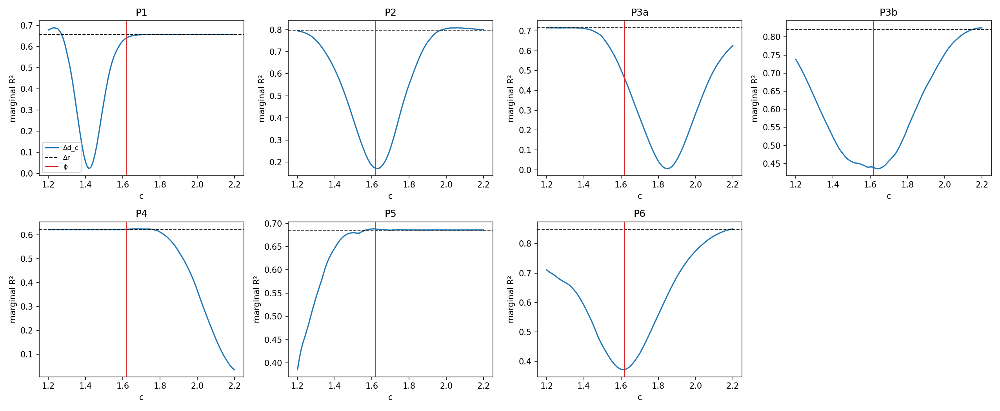
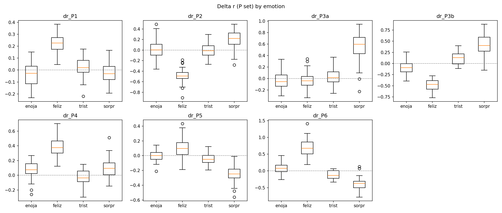
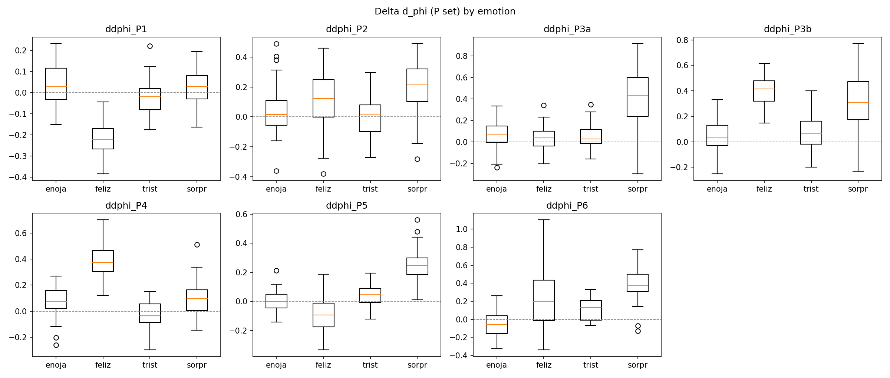
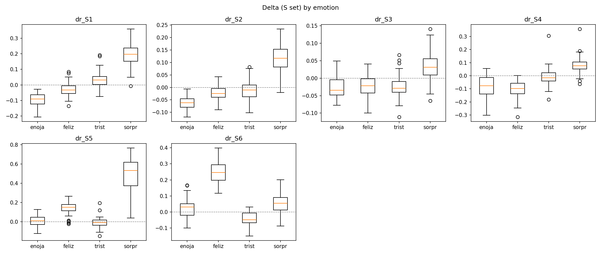
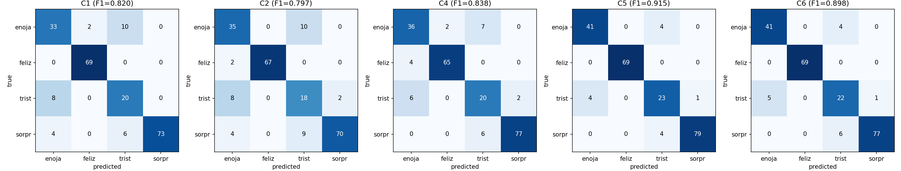

# SUMMARY

## Step 3 — Statistics

Mixed model `delta ~ emotion + (1|sujeto)` (ML). Marginal R² (Nakagawa). p = likelihood-ratio test of the emotion term (3 df); Holm over 20 tests.

| feature   | delta   |   n |   marginal_R2 |   p_LRT |   p_holm |
|:----------|:--------|----:|--------------:|--------:|---------:|
| P1        | dr      | 225 |        0.6578 |       0 |        0 |
| P2        | dr      | 225 |        0.7979 |       0 |        0 |
| P3a       | dr      | 225 |        0.715  |       0 |        0 |
| P3b       | dr      | 225 |        0.8202 |       0 |        0 |
| P4        | dr      | 225 |        0.6227 |       0 |        0 |
| P5        | dr      | 225 |        0.6857 |       0 |        0 |
| P6        | dr      | 225 |        0.8478 |       0 |        0 |
| S1        | dr      | 225 |        0.8129 |       0 |        0 |
| S2        | dr      | 225 |        0.7455 |       0 |        0 |
| S3        | dr      | 225 |        0.3954 |       0 |        0 |
| S4        | dr      | 225 |        0.571  |       0 |        0 |
| S5        | dr      | 225 |        0.7838 |       0 |        0 |
| S6        | dr      | 225 |        0.7676 |       0 |        0 |
| P1        | d_phi   | 225 |        0.641  |       0 |        0 |
| P2        | d_phi   | 225 |        0.1719 |       0 |        0 |
| P3a       | d_phi   | 225 |        0.4633 |       0 |        0 |
| P3b       | d_phi   | 225 |        0.4391 |       0 |        0 |
| P4        | d_phi   | 225 |        0.6239 |       0 |        0 |
| P5        | d_phi   | 225 |        0.6879 |       0 |        0 |
| P6        | d_phi   | 225 |        0.3712 |       0 |        0 |

### c-sweep (marginal R², P set)

| feature   |   R2_dr |   R2_dphi(c=1.62) |   best_c |   R2_best_c |   R2_midpoint |   R2_median_rneu |
|:----------|--------:|------------------:|---------:|------------:|--------------:|-----------------:|
| P1        |  0.6578 |            0.6421 |     1.23 |      0.6893 |        0.0257 |           0.5243 |
| P2        |  0.7979 |            0.1712 |     2.06 |      0.808  |        0.1813 |           0.5667 |
| P3a       |  0.715  |            0.4588 |     1.2  |      0.7157 |        0.0289 |           0.6273 |
| P3b       |  0.8202 |            0.4386 |     2.2  |      0.8253 |        0.4406 |           0.4395 |
| P4        |  0.6227 |            0.624  |     1.67 |      0.6258 |        0.0521 |           0.4023 |
| P5        |  0.6857 |            0.6879 |     1.61 |      0.6881 |        0.1965 |           0.3678 |
| P6        |  0.8478 |            0.3717 |     2.2  |      0.8502 |        0.4304 |           0.6308 |

### Boxplots

## Step 4 — Classification
Leave-one-subject-out, 4 classes, nearest centroid (Euclidean) on z-scores fitted on training folds only. Bootstrap: 2000 subject-level resamples, same predictions.
### Macro-F1
| condition   |   n_features |   macro_F1 |   F1_enojado |   F1_feliz |   F1_triste |   F1_sorprendido |
|:------------|-------------:|-----------:|-------------:|-----------:|------------:|-----------------:|
| C1          |            7 |     0.82   |       0.7333 |     0.9857 |      0.625  |           0.9359 |
| C2          |            7 |     0.7968 |       0.7447 |     0.9853 |      0.5538 |           0.9032 |
| C4          |            6 |     0.8384 |       0.7912 |     0.9559 |      0.6557 |           0.9506 |
| C5          |           13 |     0.915  |       0.9111 |     1      |      0.7797 |           0.9693 |
| C6          |           13 |     0.8977 |       0.9011 |     1      |      0.7333 |           0.9565 |
### Bootstrap 95% CI of macro-F1 difference
| comparison   |   observed_diff |   ci95_low |   ci95_high |   boot_mean |   n_boot |   n_subjects |
|:-------------|----------------:|-----------:|------------:|------------:|---------:|-------------:|
| C2-C1        |         -0.0232 |    -0.0523 |      0.0062 |     -0.0227 |     2000 |          103 |
| C2-C4        |         -0.0416 |    -0.1097 |      0.0268 |     -0.041  |     2000 |          103 |
| C6-C5        |         -0.0173 |    -0.0446 |      0.0075 |     -0.0174 |     2000 |          103 |
### Confusion matrices (counts; rows = true)

**C1**
|                  |   pred_enojado |   pred_feliz |   pred_triste |   pred_sorprendido |
|:-----------------|---------------:|-------------:|--------------:|-------------------:|
| true_enojado     |             33 |            2 |            10 |                  0 |
| true_feliz       |              0 |           69 |             0 |                  0 |
| true_triste      |              8 |            0 |            20 |                  0 |
| true_sorprendido |              4 |            0 |             6 |                 73 |

**C2**
|                  |   pred_enojado |   pred_feliz |   pred_triste |   pred_sorprendido |
|:-----------------|---------------:|-------------:|--------------:|-------------------:|
| true_enojado     |             35 |            0 |            10 |                  0 |
| true_feliz       |              2 |           67 |             0 |                  0 |
| true_triste      |              8 |            0 |            18 |                  2 |
| true_sorprendido |              4 |            0 |             9 |                 70 |

**C4**
|                  |   pred_enojado |   pred_feliz |   pred_triste |   pred_sorprendido |
|:-----------------|---------------:|-------------:|--------------:|-------------------:|
| true_enojado     |             36 |            2 |             7 |                  0 |
| true_feliz       |              4 |           65 |             0 |                  0 |
| true_triste      |              6 |            0 |            20 |                  2 |
| true_sorprendido |              0 |            0 |             6 |                 77 |

**C5**
|                  |   pred_enojado |   pred_feliz |   pred_triste |   pred_sorprendido |
|:-----------------|---------------:|-------------:|--------------:|-------------------:|
| true_enojado     |             41 |            0 |             4 |                  0 |
| true_feliz       |              0 |           69 |             0 |                  0 |
| true_triste      |              4 |            0 |            23 |                  1 |
| true_sorprendido |              0 |            0 |             4 |                 79 |

**C6**
|                  |   pred_enojado |   pred_feliz |   pred_triste |   pred_sorprendido |
|:-----------------|---------------:|-------------:|--------------:|-------------------:|
| true_enojado     |             41 |            0 |             4 |                  0 |
| true_feliz       |              0 |           69 |             0 |                  0 |
| true_triste      |              5 |            0 |            22 |                  1 |
| true_sorprendido |              0 |            0 |             6 |                 77 |
